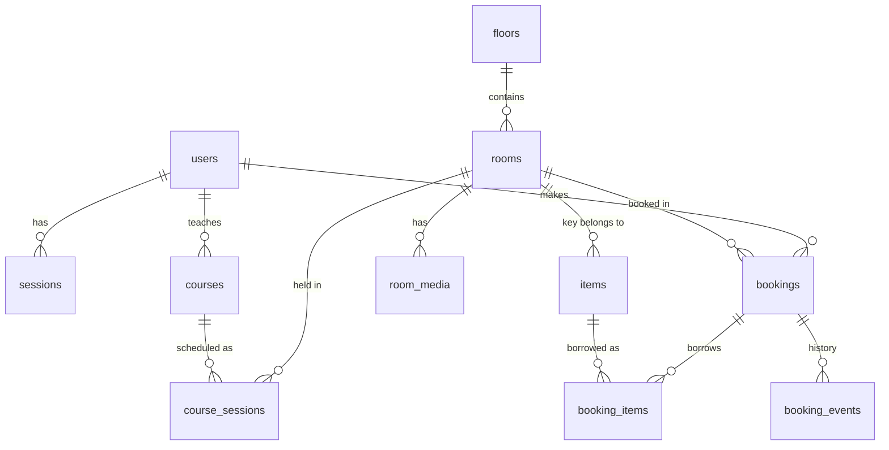

# 資料模型與業務規則

資料表定義在 `apps/api/src/db/schema/`，這裡說明關係和規則。



## 帳號（core）

- `users`：以 LINE user ID 識別。狀態 `unregistered → pending → approved / rejected`，角色 `user / teacher / admin`。
- 第一次 LINE 登入自動建立 `unregistered` 使用者，導向註冊頁；填完變 `pending`；管理員核准時決定角色。
- 第一位管理員用指令設定（見 README「上線與管理員」）。
- 顯示人名用 `name`（註冊時填的真名），沒有時用 `line_display_name`。後端用 `auth/users.ts` 的 `toUserRef()`。

## 時間

- 資料庫一律存 `timestamptz`。系統只用台北時間（UTC+8，無日光節約），換算用 `@class/shared/time`。
- 時段一律是半開區間 `[開始, 結束)`：10:00–12:00 和 12:00–13:00 不算重疊。
- 預約可用時段 08:00–21:00，以 10 分鐘為單位（`BOOKING_*` 常數）。排課同樣以 10 分鐘為單位。

## 空間（space）

- `floors`：建築 + 樓層（`管理學院` B1、1F–4F；`教學大樓A` B1、1F、3F）。可上傳平面圖圖片（`plan_image_path`），沒有圖片時平面圖以格線顯示。
- `rooms`：`code` 唯一（例：`管212`）。`is_bookable=false` 的空間（辦公室、研究室）可以瀏覽但不能預約。刪除是軟刪除（`is_active=false`）。
- 教室在平面圖上的位置是矩形 `plan_x/y/w/h`（平面圖座標）。
- `room_media`：`panorama`（等距長方投影的 360 全景 JPEG，2:1）、`mesh`（3D 格局 GLB 檔）、`splat`（3D 實景 SPZ 檔）、`photo`。檔案在媒體資料夾，資料庫只存相對路徑。

## 預約借用（booking）

狀態機：

```
pending ──核准──> approved ──借出──> checked_out ──歸還──> returned
   │                  │
   ├──退件──> rejected │
   └──取消──> cancelled <┘（管理員可取消已核准）
```

- 每次狀態變化寫一筆 `booking_events`（誰、什麼動作、備註、時間），借用歷史從這裡來。
- 物品 `items`：鑰匙（`category=key`，綁定 `room_id`，通常數量 1）與共用物品（投影筆、筆電...）。
- 物品可借數量 = `quantity` −（該時段重疊、狀態為 approved / checked_out 的預約借走的數量）。建立和核准時都要檢查。
- 預約之間的重疊：同教室、狀態為 approved / checked_out 的預約時段不能重疊，由資料庫 EXCLUDE 約束保證（錯誤碼 23P01，用 `isExclusionViolation` 判斷）。待審核的預約可以互相重疊，核准其中一筆後其他的就核准不了。

## 課程排課（scheduling）

- `courses`：課程本身（名稱、課號、授課教師、希望的教室）。教師建立的課程 `teacher_id` 一律是自己；管理員可以先建立再指派。
- `course_sessions`：每一次上課的實際時段與教室。可以一次建立「每週重複 N 次」。`room_id` 為 null 表示還沒排教室。
- 課程時段之間**允許重疊**，重疊會出現在管理員的衝突清單：
  - `room_course`：同教室兩個課程時段重疊
  - `room_booking`：課程時段與已核准的預約重疊
  - `teacher`：同一位教師兩個時段重疊

## 教室占用（整合核心）

一間教室在某時段「被占用」= 以下任一成立：

1. 有狀態為 `approved` 或 `checked_out` 的預約
2. 有狀態為 `scheduled`、且指定了這間教室的課程時段

規則：

- 建立預約、核准預約時，該時段被課程或其他已核准預約占用 → 409 `ROOM_OCCUPIED`。
- 排課**不受**預約限制（課程優先），但重疊會列入衝突清單，由管理員處理。
- 唯一的計算入口是 `apps/api/src/core/occupancy.ts`；前端用 `GET /api/occupancy?from&to[&roomId]`。
